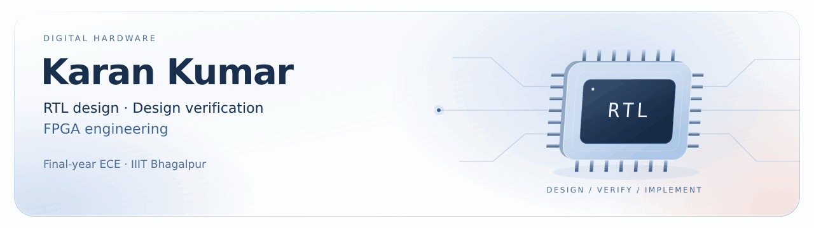

<picture>
  <source media="(prefers-color-scheme: dark) and (prefers-reduced-motion: reduce)" srcset="assets/glass-header-dark-static.png">
  <source media="(prefers-reduced-motion: reduce)" srcset="assets/glass-header-light-static.png">
  <source type="image/webp" media="(prefers-color-scheme: dark)" srcset="assets/glass-header-dark.webp">
  <source media="(prefers-color-scheme: dark)" srcset="assets/glass-header-dark.gif">
  <source type="image/webp" srcset="assets/glass-header-light.webp">
  
</picture>

**Final-year Electronics and Communication Engineering student at IIIT Bhagalpur.**

I build digital hardware and verify how it behaves: processor pipelines, AXI interfaces, FPGA accelerators, and CMOS circuits. I am looking for internships and entry-level roles in **RTL design, design verification, and FPGA engineering**.

<a href="https://krnroyy.github.io/responsive-personal-portfolio/"><picture><source media="(prefers-color-scheme: dark)" srcset="assets/glass-portfolio-dark.svg"></picture></a>
<a href="https://www.linkedin.com/in/krnroyy/"><picture><source media="(prefers-color-scheme: dark)" srcset="assets/glass-linkedin-dark.svg"></picture></a>

## Selected work

| Project | What I designed and verified |
| :--- | :--- |
| **[Five-stage RV32I subset processor](https://github.com/Krnroyy/rv32i-pipelined-processor)** | Forwarding, load-use interlocks and control-flow flushes; UVM, directed tests and bounded formal safety checks. |
| **[AXI4-Stream FIFO](https://github.com/Krnroyy/axi4-stream-fifo)** | Parameterized beat FIFO; scoreboard simulation, scoped formal proof and a documented injected-bug case study. |
| **[Pipelined 8-bit ALU](https://github.com/Krnroyy/pipelined-8bit-alu)** | Five RTL implementations compared through exhaustive tests, UVM, equivalence and an educational SKY130HD flow. |
| **[AXI4-Lite timer](https://github.com/Krnroyy/axi-lite-timer)** | Independent write channels, byte strobes and interrupts; UVM checks for register behaviour, completion and reset. |
| **[AES-GCM accelerator](https://github.com/Krnroyy/fpga-aes128-gcm-image-encryption)** | Custom Verilog with AXI DMA and Cortex-A53 software; documented reference comparisons and tamper tests. |
| **[CMOS full adder](https://github.com/Krnroyy/cadence-cmos-full-adder)** | gpdk180 schematic design in Virtuoso; Spectre functional simulation and output-load characterization. |

### Results and scope

Expand a project for its documented results, limits, and evidence links.

<b>Five-stage RV32I Subset Processor — ZCU104</b>

32-bit in-order pipeline with forwarding, load-use interlocks, and branch/jump flushes.

- XSIM/UVM: three seeds, 225 retirements per seed, 37/37 instruction bins and 12/12 branch bins.
- Directed simulation and 40-step bounded formal safety checks; portable regression in GitHub Actions.
- Programmed ZCU104 demo produced the expected LED pattern `1101`.

Scope: RV32I subset; no full ISA compliance or unbounded architectural proof is claimed. The fixed-ROM board demo uses a 125 MHz clock target; routed timing is a tool estimate, not measured maximum frequency.

[Repository](https://github.com/Krnroyy/rv32i-pipelined-processor) · [Verification](https://github.com/Krnroyy/rv32i-pipelined-processor/blob/main/docs/test_plan.md) · [Board evidence](https://github.com/Krnroyy/rv32i-pipelined-processor/blob/main/docs/zcu104_demo.md) · [CI](https://github.com/Krnroyy/rv32i-pipelined-processor/actions/workflows/rtl-regression.yml)

<b>AXI4-Stream FIFO — Simulation and Formal Verification</b>

Parameterized SystemVerilog beat FIFO preserving TDATA, TKEEP, and TLAST, with scoreboard-based simulation and formal safety checks.

- 12 passing simulation runs across depths 1, 3, 4, and 16.
- Formal base checks and induction passed for an 8-bit, depth-4 configuration under documented assumptions.
- Deliberately injected handshake bug detected by simulation and formal verification.
- Automated simulation and formal checks through GitHub Actions.

[Repository](https://github.com/Krnroyy/axi4-stream-fifo) · [Validation](https://github.com/Krnroyy/axi4-stream-fifo/blob/master/results/VALIDATION.md) · [Bug case study](https://github.com/Krnroyy/axi4-stream-fifo/blob/master/docs/BUG_CASE_STUDY.md)

<b>Pipelined 8-bit ALU — RTL to GDS</b>

Compared five SystemVerilog implementations using exhaustive tests, UVM, Yosys equivalence and SKY130HD/OpenROAD implementation.

- 524,288 opcode/operand cases per variant; 43 equivalence points proved for shared ADD/SUB.
- Shared ADD/SUB reduced estimated routed cell area by 5.9%, with less timing margin than the baseline.

Scope: educational RTL-to-GDS flow; no fabrication or production foundry signoff.

[Repository](https://github.com/Krnroyy/pipelined-8bit-alu) · [Results](https://github.com/Krnroyy/pipelined-8bit-alu/blob/main/docs/PROJECT_COMPLETION.md) · [v1.1.0 release](https://github.com/Krnroyy/pipelined-8bit-alu/releases/tag/v1.1.0)

<b>AXI4-Lite Countdown Timer — UVM Verification</b>

Memory-mapped SystemVerilog timer with independent AXI write channels, byte strobes, countdown, busy status and interrupts. UVM checks cover register behaviour, completion, interrupt clearing and reset recovery.

[Repository and verification](https://github.com/Krnroyy/axi-lite-timer)

<b>AES-GCM Hardware Accelerator — ZCU104</b>

Custom Verilog accelerator integrated with AXI DMA and Cortex-A53 software, with Python reference verification.

- Documented board tests: 11/11 ciphertext and authentication-tag matches against Python AESGCM.
- Modified ciphertext rejected in all 11 documented tamper tests.
- Compared CTR and GCM implementations for throughput, resource utilization, and timing.

[Repository](https://github.com/Krnroyy/fpga-aes128-gcm-image-encryption) · [Results](https://github.com/Krnroyy/fpga-aes128-gcm-image-encryption/blob/main/RESULTS.md) · [Build instructions](https://github.com/Krnroyy/fpga-aes128-gcm-image-encryption/blob/main/BUILD_AND_RUN.md)

<b>CMOS Full Adder — Cadence Virtuoso</b>

Hierarchical 1-bit full adder designed using gpdk180 and simulated with Spectre at 1.8 V.

- Functional simulation across all eight input combinations.
- Output-load characterization from 5 fF to 50 fF.
- Documented propagation-delay measurements, average supply power, schematics, and waveforms.

Scope: schematic-level simulation; physical layout, DRC, and LVS are not included.

[Repository and results](https://github.com/Krnroyy/cadence-cmos-full-adder)

## Tools I use

| Area | Tools and technologies |
|---|---|
| RTL and verification | Verilog, SystemVerilog, UVM 1.2, XSIM, Icarus Verilog, GTKWave |
| Formal verification | Yosys/SMTBMC, Z3 |
| FPGA and interfaces | Vivado, Vitis, ZCU104, AXI4-Stream, AXI4-Lite, AXI DMA |
| Physical implementation | OpenROAD, ORFS, SKY130HD |
| CMOS design | Cadence Virtuoso, Spectre, gpdk180 |
| Programming and workflow | Python, C/C++, Git, GitHub Actions, WSL Ubuntu |

## What I am working on

Processor microarchitecture, hazard handling, UVM scoreboards and formal safety properties, with reproducible tests and clearly scoped implementation results.

[Explore my portfolio](https://krnroyy.github.io/responsive-personal-portfolio/) · [Connect on LinkedIn](https://www.linkedin.com/in/krnroyy/)