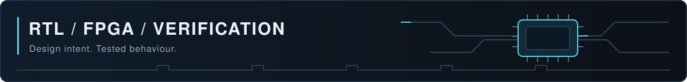

<h1 align="center">Karan Kumar</h1>

ECE final-year student at IIIT Bhagalpur · RTL design, FPGA development, and hardware verification

## Selected Projects

| Project | What it demonstrates | Explore |
|---|---|---|
| **[AXI4-Stream FIFO](https://github.com/Krnroyy/axis-packet-fifo)** | SystemVerilog RTL, scoreboard simulation, and formal safety checks | [Validation](https://github.com/Krnroyy/axis-packet-fifo/blob/master/results/VALIDATION.md) · [Bug case study](https://github.com/Krnroyy/axis-packet-fifo/blob/master/docs/BUG_CASE_STUDY.md) · [Waveform](https://github.com/Krnroyy/axis-packet-fifo#backpressure-waveform) |
| **[FPGA AES-128-GCM](https://github.com/Krnroyy/FPGA-AES128-CTR-Image-Encryption)** | ZCU104 accelerator, AXI DMA, Cortex-A53 integration, and Python reference checks | [Results](https://github.com/Krnroyy/FPGA-AES128-CTR-Image-Encryption/blob/main/RESULTS.md) · [Build guide](https://github.com/Krnroyy/FPGA-AES128-CTR-Image-Encryption/blob/main/BUILD_AND_RUN.md) |
| **[CMOS Full Adder](https://github.com/Krnroyy/cadence-cmos-full-adder)** | gpdk180 schematic design, eight-state verification, and load characterization | [Schematics & results](https://github.com/Krnroyy/cadence-cmos-full-adder#readme) |

*FIFO formal results apply to the documented 8-bit, depth-4 configuration and harness assumptions. The full-adder project covers schematic simulation.*

## Toolkit

| Area | Tools and interfaces used in my projects |
|---|---|
| Verification | Icarus Verilog, GTKWave, Yosys/SMTBMC, Z3, GitHub Actions |
| FPGA | Vivado, Vitis, AXI4-Stream, AXI4-Lite, AXI DMA |
| Circuits | Cadence Virtuoso, Spectre, gpdk180 |
| Software & workflow | Python, C/C++, Git, WSL Ubuntu |

## Learning & Opportunities

Currently studying AXI interfaces, FIFO verification, formal properties, and AES-GCM hardware architecture.

Open to internships, entry-level opportunities, and engineering collaboration. Connect through [LinkedIn](https://www.linkedin.com/in/krnroyy/).
